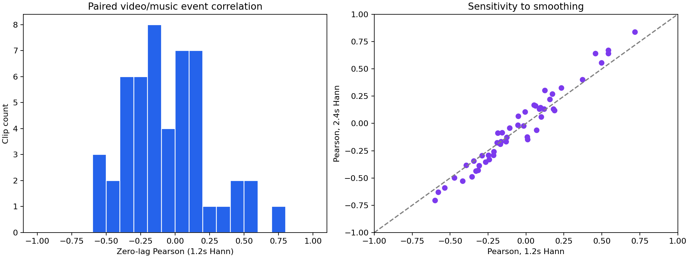
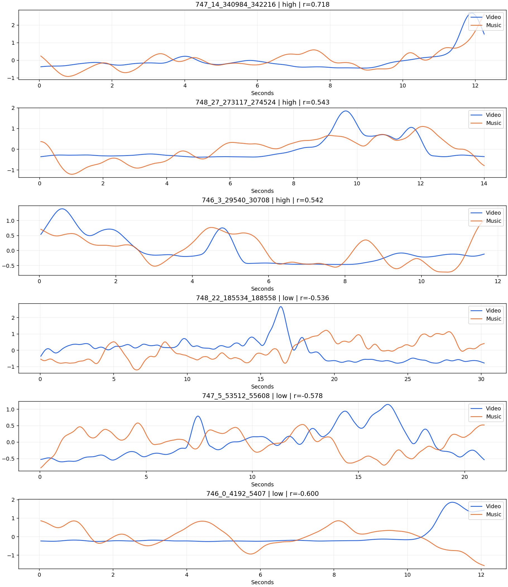

# OSSL Video–Music Event Alignment: 50-Pair Report

All 50 pairs completed successfully. Click a clip ID below to view its comparison plot.

[Ranked scores (CSV)](alignment_scores.csv) · [Analysis configuration](analysis_config.json) · [Summary](summary.json)

## Method

Video and paired music curves are independently standardized, interpolated onto a common 25 Hz time grid, and smoothed with a 31-point symmetric Hann window (1.2-second endpoint span). The primary score is zero-lag Pearson correlation. Blue denotes video; orange denotes music.

Paired clips are assumed to share their start time. No fitted time shift is used for the primary score. Positive diagnostic lag means music changes occur later; lag correlations use a fixed cropped interval and are not directly comparable to the primary full-interval score.

High and low are the top and bottom 20% of eligible samples in this batch, not absolute music-quality labels. These 50 clips come from only three movies and do not represent the entire dataset. Median zero-lag Pearson: **−0.081**.

## Overview

## High- and Low-Scoring Examples

## All 50 Samples

| Rank | Clip ID | Pearson (1.2 s) | Pearson (2.4 s) | Best lag (s) | Group | Quality flag |
| ---: | --- | ---: | ---: | ---: | --- | --- |
| 1 | [747_14_340984_342216](clips/test/747/747_14_340984_342216/comparison.png) | 0.718 | 0.838 | +1.36 | high | ok |
| 2 | [748_27_273117_274524](clips/test/748/748_27_273117_274524/comparison.png) | 0.543 | 0.642 | -0.88 | high | ok |
| 3 | [746_3_29540_30708](clips/test/746/746_3_29540_30708/comparison.png) | 0.542 | 0.671 | -0.20 | high | ok |
| 4 | [747_3_31509_32596](clips/test/747/747_3_31509_32596/comparison.png) | 0.498 | 0.555 | +0.56 | high | ok |
| 5 | [747_13_208770_210098](clips/test/747/747_13_208770_210098/comparison.png) | 0.457 | 0.642 | -1.96 | high | ok |
| 6 | [748_19_169788_171835](clips/test/748/748_19_169788_171835/comparison.png) | 0.371 | 0.402 | -0.16 | high | ok |
| 7 | [747_1_14530_15681](clips/test/747/747_1_14530_15681/comparison.png) | 0.233 | 0.326 | +0.96 | high | ok |
| 8 | [748_16_151049_153512](clips/test/748/748_16_151049_153512/comparison.png) | 0.188 | 0.120 | -1.68 | high | ok |
| 9 | [747_22_514437_515524](clips/test/747/747_22_514437_515524/comparison.png) | 0.180 | 0.134 | +0.04 | high | ok |
| 10 | [748_0_8785_9872](clips/test/748/748_0_8785_9872/comparison.png) | 0.174 | 0.272 | -2.00 | high | ok |
| 11 | [748_29_291152_292687](clips/test/748/748_29_291152_292687/comparison.png) | 0.156 | 0.220 | +0.64 | middle | ok |
| 12 | [748_28_280910_282142](clips/test/748/748_28_280910_282142/comparison.png) | 0.123 | 0.304 | +0.68 | middle | ok |
| 13 | [747_15_397858_401505](clips/test/747/747_15_397858_401505/comparison.png) | 0.120 | 0.134 | -0.20 | middle | ok |
| 14 | [747_11_198321_199664](clips/test/747/747_11_198321_199664/comparison.png) | 0.101 | 0.061 | +0.36 | middle | ok |
| 15 | [748_26_257482_258618](clips/test/748/748_26_257482_258618/comparison.png) | 0.095 | 0.146 | -0.64 | middle | ok |
| 16 | [748_21_183966_185405](clips/test/748/748_21_183966_185405/comparison.png) | 0.088 | 0.132 | -0.52 | middle | ok |
| 17 | [748_24_242280_243431](clips/test/748/748_24_242280_243431/comparison.png) | 0.070 | -0.061 | +2.00 | middle | ok |
| 18 | [747_21_509940_512548](clips/test/747/747_21_509940_512548/comparison.png) | 0.063 | 0.164 | +2.00 | middle | ok |
| 19 | [747_7_136598_137685](clips/test/747/747_7_136598_137685/comparison.png) | 0.053 | 0.169 | -1.76 | middle | ok |
| 20 | [748_18_156442_157785](clips/test/748/748_18_156442_157785/comparison.png) | 0.010 | -0.146 | -2.00 | middle | ok |
| 21 | [746_1_6129_7728](clips/test/746/746_1_6129_7728/comparison.png) | 0.007 | -0.122 | +0.20 | middle | ok |
| 22 | [748_17_154985_156185](clips/test/748/748_17_154985_156185/comparison.png) | -0.005 | 0.107 | -1.68 | middle | ok |
| 23 | [748_11_71099_79420](clips/test/748/748_11_71099_79420/comparison.png) | -0.016 | -0.020 | +2.00 | middle | ok |
| 24 | [748_25_244552_246648](clips/test/748/748_25_244552_246648/comparison.png) | -0.050 | 0.067 | -1.76 | middle | ok |
| 25 | [748_15_132982_134229](clips/test/748/748_15_132982_134229/comparison.png) | -0.054 | -0.014 | -1.84 | middle | ok |
| 26 | [748_23_191823_197023](clips/test/748/748_23_191823_197023/comparison.png) | -0.109 | -0.041 | +2.00 | middle | ok |
| 27 | [747_16_407539_409315](clips/test/747/747_16_407539_409315/comparison.png) | -0.127 | -0.125 | -1.84 | middle | ok |
| 28 | [748_14_130853_132661](clips/test/748/748_14_130853_132661/comparison.png) | -0.133 | -0.167 | +1.84 | middle | ok |
| 29 | [747_19_497426_503266](clips/test/747/747_19_497426_503266/comparison.png) | -0.158 | -0.085 | -1.20 | middle | ok |
| 30 | [748_13_82813_86957](clips/test/748/748_13_82813_86957/comparison.png) | -0.165 | -0.166 | -1.04 | middle | ok |
| 31 | [747_0_5696_8432](clips/test/747/747_0_5696_8432/comparison.png) | -0.171 | -0.189 | +0.52 | middle | ok |
| 32 | [747_9_150025_151400](clips/test/747/747_9_150025_151400/comparison.png) | -0.185 | -0.088 | +2.00 | middle | ok |
| 33 | [747_10_151817_161145](clips/test/747/747_10_151817_161145/comparison.png) | -0.191 | -0.175 | +1.48 | middle | ok |
| 34 | [748_1_10673_12833](clips/test/748/748_1_10673_12833/comparison.png) | -0.213 | -0.259 | +1.32 | middle | ok |
| 35 | [747_4_49224_51975](clips/test/747/747_4_49224_51975/comparison.png) | -0.216 | -0.290 | -0.88 | middle | ok |
| 36 | [747_8_146360_149975](clips/test/747/747_8_146360_149975/comparison.png) | -0.243 | -0.329 | +1.20 | middle | ok |
| 37 | [746_4_187663_188782](clips/test/746/746_4_187663_188782/comparison.png) | -0.249 | -0.289 | +1.80 | middle | ok |
| 38 | [747_20_504468_507731](clips/test/747/747_20_504468_507731/comparison.png) | -0.267 | -0.354 | +0.72 | middle | ok |
| 39 | [748_12_79645_82780](clips/test/748/748_12_79645_82780/comparison.png) | -0.290 | -0.294 | +1.00 | middle | ok |
| 40 | [747_18_413252_414388](clips/test/747/747_18_413252_414388/comparison.png) | -0.309 | -0.386 | +1.56 | middle | ok |
| 41 | [747_6_55705_57784](clips/test/747/747_6_55705_57784/comparison.png) | -0.316 | -0.430 | +1.52 | low | ok |
| 42 | [747_2_15842_18514](clips/test/747/747_2_15842_18514/comparison.png) | -0.331 | -0.436 | +2.00 | low | ok |
| 43 | [747_17_409572_412419](clips/test/747/747_17_409572_412419/comparison.png) | -0.345 | -0.343 | +1.32 | low | ok |
| 44 | [747_12_202257_203696](clips/test/747/747_12_202257_203696/comparison.png) | -0.357 | -0.487 | -2.00 | low | ok |
| 45 | [748_10_68763_69978](clips/test/748/748_10_68763_69978/comparison.png) | -0.395 | -0.382 | +0.12 | low | ok |
| 46 | [748_20_175853_176972](clips/test/748/748_20_175853_176972/comparison.png) | -0.417 | -0.527 | +0.28 | low | ok |
| 47 | [746_2_11089_12225](clips/test/746/746_2_11089_12225/comparison.png) | -0.473 | -0.498 | +0.92 | low | ok |
| 48 | [748_22_185534_188558](clips/test/748/748_22_185534_188558/comparison.png) | -0.536 | -0.591 | +2.00 | low | ok |
| 49 | [747_5_53512_55608](clips/test/747/747_5_53512_55608/comparison.png) | -0.578 | -0.628 | -2.00 | low | ok |
| 50 | [746_0_4192_5407](clips/test/746/746_0_4192_5407/comparison.png) | -0.600 | -0.705 | -1.84 | low | ok |

## Offline HTML Report

Download or clone the repository, then open `reports/ossl-test-50/report.html` in a browser. Keep its companion files and folders together so the plots and downloads remain available.
