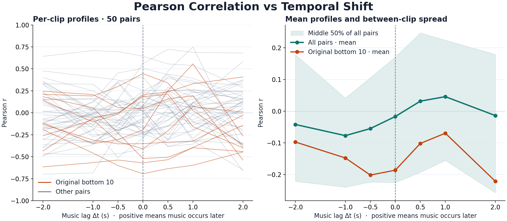

# Experiment 1 · Temporal Shift Test

## Pearson Correlation vs Temporal Shift

The left panel shows all 50 clip profiles, with the original bottom 10 highlighted. The right panel shows the arithmetic mean across all pairs and across the bottom 10. Shading marks the 25th to 75th percentiles across clips.

| Music lag (s) | Mean Pearson r, all 50 | Mean Pearson r, original bottom 10 | Mean absolute change from zero lag, all 50 |
| ---: | ---: | ---: | ---: |
| −2.0 | −0.042 | −0.097 | 0.298 |
| −1.0 | −0.077 | −0.147 | 0.216 |
| −0.5 | −0.055 | −0.201 | 0.152 |
| 0.0 | −0.017 | −0.186 | 0.000 |
| +0.5 | +0.032 | −0.102 | 0.154 |
| +1.0 | +0.046 | −0.069 | 0.245 |
| +2.0 | −0.014 | −0.221 | 0.298 |

## Results

- **Where does correlation peak?** The mean profile peaked at **+1.0 s** among the seven shifts, gaining **0.062** over zero lag. At the clip level, the best tested shift was positive for **26** clips, negative for **18**, and zero for **6**. Thirteen clips peaked within ±0.5 s, including zero. Twenty-five peaked at either endpoint of the search, so their peak locations are bounded by the search range.
- **How sensitive is Pearson to a small shift?** A shift of −0.5 s changed Pearson by an average of **0.152** in absolute value, and +0.5 s changed it by **0.154**. The change was at least 0.20 for **16** clips at −0.5 s and **15** at +0.5 s.
- **Can delay explain some low scores?** Among the 10 clips in the original report's bottom Pearson group, **7** gained at least **0.20** at their best tested shift. **3** changed from negative to positive on the common interval. The group's mean improved from **−0.186** at zero to **−0.069** at +1.0 s. The examples below show a later match, an earlier match, and a clip whose score improved but stayed negative.

| Clip | Pearson r at zero lag | Best tested lag (s) | Pearson r at best lag |
| --- | ---: | ---: | ---: |
| [746_2_11089_12225](../clips/test/746/746_2_11089_12225/comparison.png) | −0.195 | +1.0 | +0.556 |
| [747_12_202257_203696](../clips/test/747/747_12_202257_203696/comparison.png) | −0.520 | −2.0 | +0.183 |
| [747_5_53512_55608](../clips/test/747/747_5_53512_55608/comparison.png) | −0.693 | −2.0 | −0.190 |

## Method

For each clip, compute Pearson r between the video curve at time t and the music curve at t + Δt, for Δt ∈ {−2, −1, −0.5, 0, +0.5, +1, +2} seconds. A positive Δt compares the video with a later point in the soundtrack. A positive peak is consistent with the music following a visual change, and a negative peak is consistent with the music leading it.

The analysis uses the saved 25 Hz curves after the original 31-point Hann smoothing. Every shift for a clip uses the same video time interval, trimmed by 2 seconds at each end. The ±0.5 s shifts land between samples and use linear interpolation. The fixed-interval zero-lag scores were checked against the original report's fixed-support baseline. The bottom 10 were selected using the original report's full-interval zero-lag ranking.

The results describe 50 selected clips from three films. Peak selection can increase r by chance, particularly for clips selected for low baseline scores. Treat candidate leads and lags as clips to inspect. Effect sizes are descriptive, and the shaded interval represents between-clip spread.

## Data and Reproduction

- [Per-clip scores at all seven shifts](per_clip.csv)
- [Aggregate scores](aggregate.csv)
- [Original alignment report](../report.html)

Run `python scripts/analyze_temporal_shift.py` from the repository root with NumPy and Matplotlib installed. The script reads the saved aligned curves and does not rerun either encoder.
