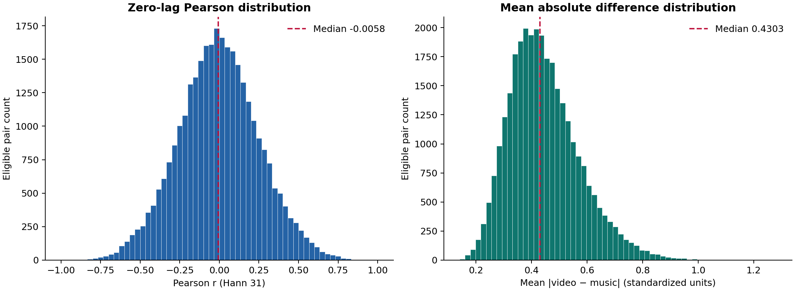
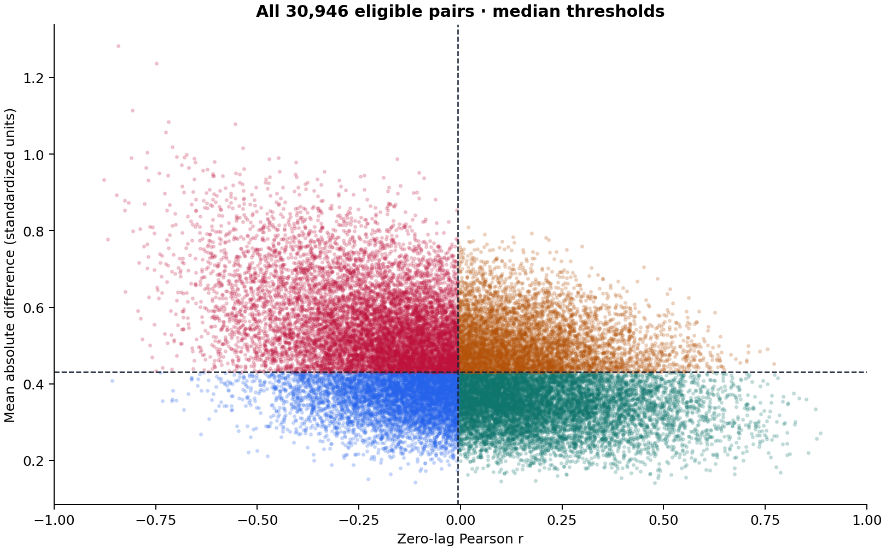
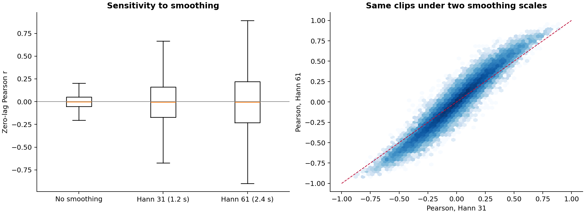

# OSSL Train Video–Music Event Alignment

Full score-table report for Lighthouse job 28185053.

- Scored pairs: 30,953; quality eligible: 30,946; movies: 1,648.
- Median Pearson: -0.005768; mean Pearson: -0.004242.
- Positive Pearson: 15,155 (48.97%); r >= 0.5: 828 (2.68%).
- Median per-pair mean absolute difference: 0.430301.
- 57 deferred OOM clips, one analysis failure, seven scored review cases.

Open `report.html` for embedded figures, examples and the searchable full score table. The source counts, medians and all eligible quadrant assignments were recomputed and reconciled. Original curves/media were not rerun or validated here.

The distribution centers near zero; strong positive correlations occur in a minority of clips. These are encoder-derived event correspondence metrics, not perceptual music-quality ratings. Relative quadrant labels must be interpreted against their median thresholds.

[Open the interactive report](https://zoehsu-code.github.io/music_generate/train/report.html) · [Download the full score table](alignment_scores.csv) · [Analysis configuration](analysis_config.json) · [Derived statistics](report_statistics.json)

## Metric distributions

## Four quadrants

| Quadrant | Pairs | Eligible share |
| --- | ---: | ---: |
| High correlation / low difference | 9,589 | 30.99% |
| High correlation / high difference | 5,884 | 19.01% |
| Low correlation / low difference | 5,884 | 19.01% |
| Low correlation / high difference | 9,589 | 30.99% |

## Smoothing sensitivity

