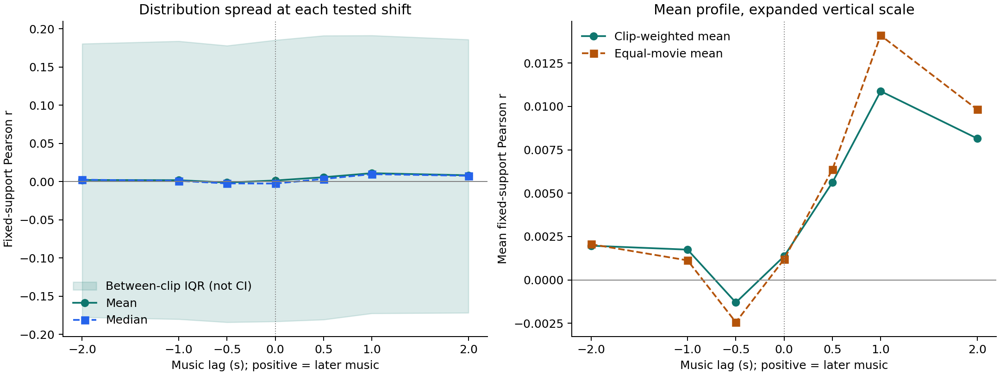
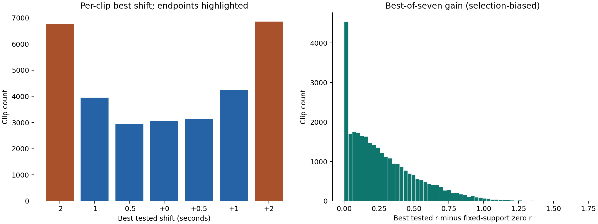
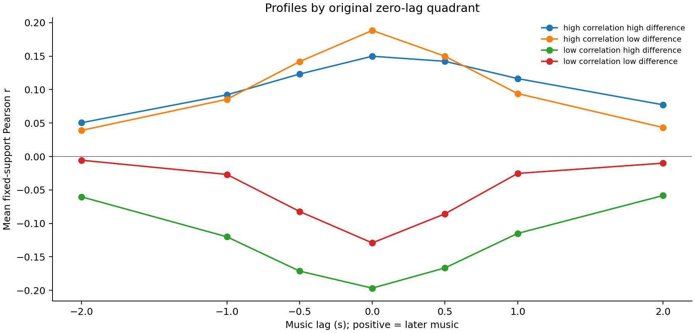

# OSSL Train Temporal Shift Report

[Open the interactive report](https://zoehsu-code.github.io/music_generate/train/temporal-shift/report.html) · [Per-clip scores](per_clip.csv) · [Group aggregates](aggregate.csv)

Completed: 30,944 pairs, 216,608 correlations. Two fixed-support near-constant failures.

Mean r peaks at +1 s (+0.010876), compared with +0.001366 at fixed zero: gain +0.009510. The aggregate effect is small. Per-clip best-of-seven gains are selection-biased; 43.98% of optima are at tested boundaries. This is not evidence for a universal time correction.

The HTML contains the method, full searchable table, examples and limitations. Statistics were recomputed from all supplied rows and reconciled against every aggregate group.
